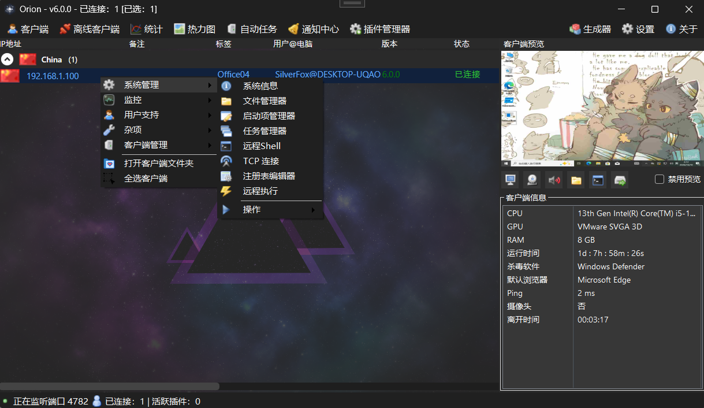
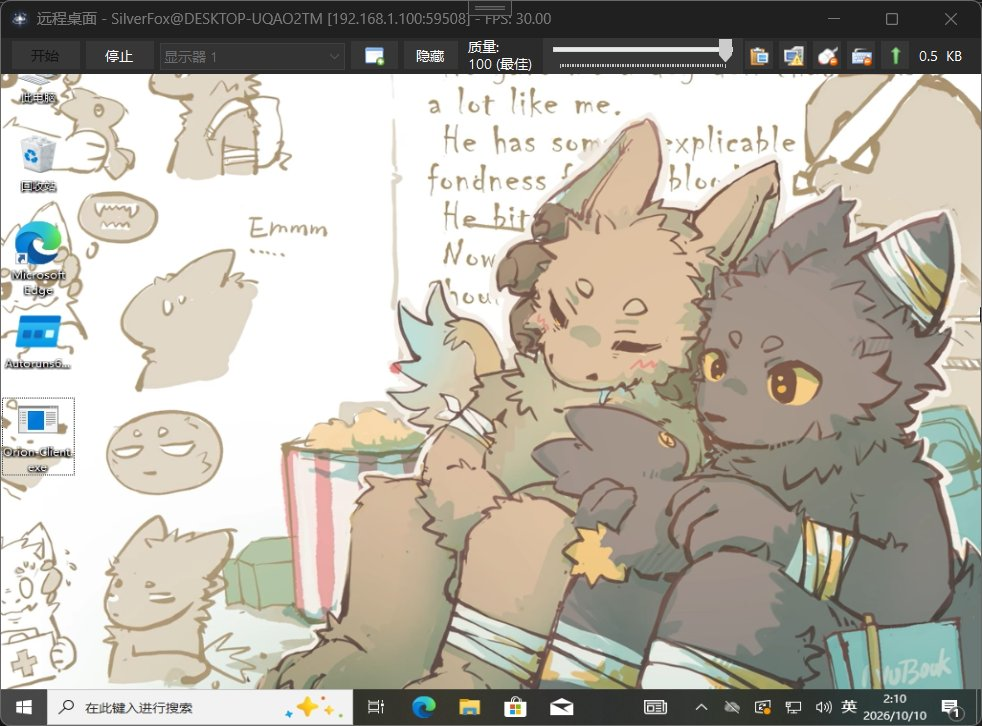
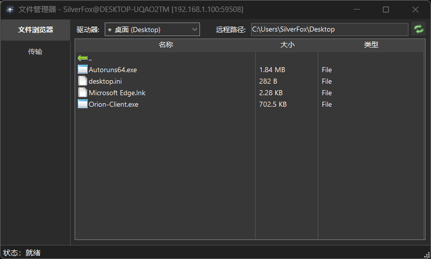

# Orion

> **一款适用于 Windows 的远程管理与安全评估工具（RAT）**

Orion 是一款采用 C# 编写的轻量级远程管理工具，可用于远程技术支持、日常系统管理、
安全评估与红队演练。它包含服务端（控端）、客户端（被控端）与公共库三个项目，
提供直观的操作界面与稳定的通信能力。

> 📚 **完整使用教程请见 [Wiki](https://github.com/SilverFox-201105/Orion-RAT/wiki)**——
> 包含首次运行、设置（含 FRP 隧道配置）、构建客户端的图文步骤。

## ⚙️ 系统要求

- 构建服务端需要 **.NET 9.0 SDK** 以及 **Visual Studio 2022**（.NET 桌面开发工作负载）
- 客户端运行于 **.NET Framework 4.8**（由构建器生成，无需目标机安装 SDK）
- 受控端运行环境：**Windows 7 SP1 及以上**（32 位 / 64 位）

## 📖 目录

* 截图展示
* 使用教程（Wiki）
* 主要功能
* 支持的平台
* 快速开始
* 编译方法
* 开源许可证
* 安全声明
* 致谢

## 📸 截图

| **主控制面板**                          | **远程桌面**                          | **文件管理器**                        |
| ---------------------------------- | --------------------------------- | -------------------------------- |
|  |  |  |

---

## 📚 使用教程（Wiki）

详细的操作步骤都写在项目的 [Wiki](https://github.com/SilverFox-201105/Orion-RAT/wiki) 中，建议按以下顺序阅读：

**上手教程（图文步骤）**

| 教程 | 内容 |
| --- | --- |
| [首次运行](https://github.com/SilverFox-201105/Orion-RAT/wiki/%E9%A6%96%E6%AC%A1%E8%BF%90%E8%A1%8C) | 免责声明、证书向导与主界面介绍 |
| [设置](https://github.com/SilverFox-201105/Orion-RAT/wiki/%E8%AE%BE%E7%BD%AE) | 监听端口、Telegram 通知、内置 FRP 隧道（含 ChmlFrp 联动示例） |
| [构建客户端](https://github.com/SilverFox-201105/Orion-RAT/wiki/%E6%9E%84%E5%BB%BA%E5%AE%A2%E6%88%B7%E7%AB%AF) | 基本 / 连接 / 安装 / 程序集四类设置与生成步骤 |

**开发文档**

| 文档 | 内容 |
| --- | --- |
| [从源码构建](https://github.com/SilverFox-201105/Orion-RAT/wiki/%E4%BB%8E%E6%BA%90%E7%A0%81%E6%9E%84%E5%BB%BA) | 编译服务端与客户端的前置条件和步骤 |
| [功能](https://github.com/SilverFox-201105/Orion-RAT/wiki/%E5%8A%9F%E8%83%BD) | 功能总览与支持的平台 |
| [插件开发](https://github.com/SilverFox-201105/Orion-RAT/wiki/%E6%8F%92%E4%BB%B6%E5%BC%80%E5%8F%91) | 服务端插件与客户端插件的编写、打包与排错 |
| [常见问题](https://github.com/SilverFox-201105/Orion-RAT/wiki/%E5%B8%B8%E8%A7%81%E9%97%AE%E9%A2%98) | 常见疑问与排查 |

---

## ✨ 主要功能

* 🌐 **TCP 网络通信** —— 支持 IPv4 与 IPv6
* 🔒 **加密通信** —— 全程采用 TLS 加密，可强制启用
* 🖥️ **远程桌面** —— 实时查看并控制远端屏幕
* 📂 **文件管理器** —— 浏览、上传、下载与删除远程文件
* 🗂️ **任务管理器** —— 查看和管理远程进程
* 🔧 **启动项管理** —— 管理系统启动程序
* 📝 **注册表编辑器** —— 远程查看与编辑 Windows 注册表
* 🔋 **系统电源控制** —— 重启、关机或注销
* 💻 **远程命令行（Shell）** —— 命令行访问远程系统
* 📜 **远程脚本执行** —— 支持 PowerShell、Batch 等脚本
* ℹ️ **系统信息** —— 获取详细的软硬件信息
* 📋 **剪贴板同步** —— 读取与写入远程剪贴板内容
* 💬 **远程聊天** —— 与远端用户实时文字交流
* 🎤 **麦克风采集** —— 录制远程麦克风音频
* 🖼️ **摄像头采集** —— 获取远程摄像头画面
* 🌐 **访问指定网站** —— 在远端浏览器打开指定页面
* 🔌 **TCP 连接查看** —— 列出远端主机的网络连接
* 🧩 **插件扩展** —— 通过插件机制扩展功能
* 💾 **内存转储** —— 导出目标进程内存用于取证分析

---

## 🖥️ 支持的平台

**运行环境：**

* .NET Framework 4.8（客户端）
* .NET 9.0（服务端构建与运行）

**支持的操作系统（32 位 / 64 位）：**

* Windows 11
* Windows 10
* Windows 8 / 8.1
* Windows 7 SP1
* Windows Server 2016 及以上

---

## 🚀 快速开始

1. 使用 Visual Studio 2022 打开 `Orion.sln` 并编译服务端。
2. 在服务端「构建器（Builder）」中生成客户端，并将生成的 `Orion.Client.exe` 部署到目标主机。
3. 目标主机运行客户端后，服务端即可在列表中看到在线设备并进行管理。

> 注意：客户端 `Orion.Client.exe` 由控制端的构建器读取 `client.bin` 并写入连接配置后生成。
> `client.bin` 需先由 `Orion.Client` 的 Release 产物生成并提供到控端目录。

图文版步骤见 Wiki 的 [首次运行](https://github.com/SilverFox-201105/Orion-RAT/wiki/%E9%A6%96%E6%AC%A1%E8%BF%90%E8%A1%8C)、[设置](https://github.com/SilverFox-201105/Orion-RAT/wiki/%E8%AE%BE%E7%BD%AE) 与 [构建客户端](https://github.com/SilverFox-201105/Orion-RAT/wiki/%E6%9E%84%E5%BB%BA%E5%AE%A2%E6%88%B7%E7%AB%AF)。

---

## 📜 开源许可证

Orion 采用 **GNU 通用公共许可证第 3 版（GPL-3.0）**——一款免费、开源的自由软件许可（全文见仓库根目录 `LICENSE.md`）：

- 允许：自由地使用、学习、修改与再分发本软件；
- 要求：任何再分发（含修改版）都须以 GPL-3.0 开源，并保留版权与许可声明。

第三方组件的许可证可在 `Licenses` 目录查看。

---

## 🛡️ 安全声明

Orion 是一款功能强大的远程管理工具，仅应用于**合法且经过授权**的场景。

未经系统所有者明确授权而使用本工具属于违法且不符合道德规范的行为。
开发者不对任何滥用行为承担责任。使用者须对自身行为独立承担全部法律责任。

---

## 🙏 致谢

感谢所有为项目提出改进建议与反馈的贡献者。

部分代码派生自开源项目 **Quasar RAT**（MIT License, Copyright (c) 2025 MaxXor），
该部分代码依其原始 MIT 许可条款提供。

感谢您使用并支持 Orion。
